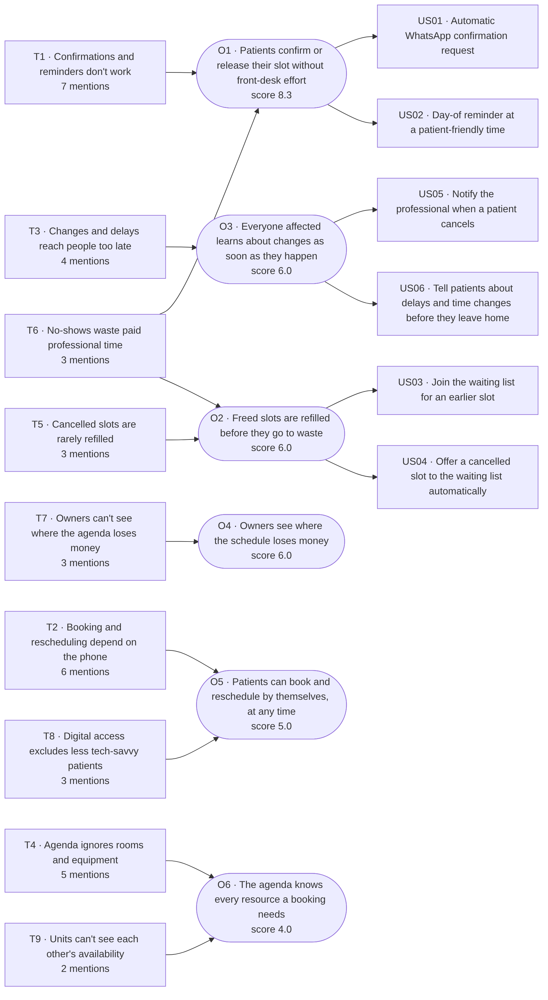
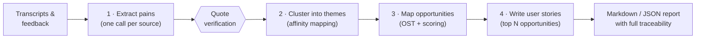

# 🔎 Discovery Agent

[](https://github.com/rafauto/discovery-agent/actions/workflows/ci.yml)


**An AI agent for Product Owners.** Paste customer interview transcripts or user feedback and get back:

1. **Pains** — each with a verbatim quote, persona and severity
2. **Themes** — pains clustered by root cause and ranked by evidence
3. **Opportunities** — an Opportunity Solution Tree with "How might we" questions, testable hypotheses and a priority score
4. **User stories** — INVEST stories with Given/When/Then acceptance criteria, **each one traceable back to the customer quotes behind it**

Built with Python and the Claude API. Also runs on Gemini's free tier, on local models via Ollama, or in a **demo mode that needs no API key at all**.



---

## Why I built this

As a Product Owner, a big part of my week is continuous discovery: running interviews, reading feedback, and turning all of it into something the team can act on. The synthesis step is slow and fragile. Notes get scattered, patterns are found by gut feeling, and by the time a story reaches refinement nobody remembers which customer actually said what.

This agent automates the tedious part of that synthesis while keeping the PO in control:

- **Evidence first.** Every pain carries a verbatim quote, and the code checks that the quote really exists in the source. Hallucinated quotes are flagged ⚠️.
- **Traceability.** Story → opportunity → themes → pains → quotes. You can always answer *"why are we building this?"*.
- **Honest prioritisation.** Opportunities are scored on impact × confidence ÷ effort, with confidence tied to how many sources back them up.
- **Problems, not solutions.** Prompts enforce discovery good practice: feature requests are translated into the underlying problem, and opportunities are phrased as customer needs.

## Example output

The repo ships with 6 **fictional** sources (5 interviews + 1 batch of NPS comments) about *ClinicFlow*, an imaginary scheduling app for small clinics. Full report: [`examples/output/discovery_report.md`](examples/output/discovery_report.md).

| Pains | Themes | Opportunities | User stories | Quotes verified |
|---|---|---|---|---|
| 36 | 9 | 6 | 6 | 36/36 |

**Top opportunities**

| ID | Opportunity | Impact | Confidence | Effort | Score |
|---|---|---|---|---|---|
| O1 | Patients confirm or release their slot without front-desk effort | 5 | 5 | 3 | **8.3** |
| O2 | Freed slots are refilled before they go to waste | 4 | 3 | 2 | **6.0** |
| O3 | Everyone affected learns about changes as soon as they happen | 3 | 4 | 2 | **6.0** |

**A generated story**

> **As a** receptionist, **I want** the system to send each patient a WhatsApp confirmation request automatically before their appointment, **so that** I stop spending my mornings sending messages by hand and can focus on patients at the desk.
>
> Opportunity: O1 · Evidence: P001, P002, P012, P016, P021, P029, P033, P003, P007, P011

```gherkin
Scenario: Patient doesn't reply
  Given the patient has not replied
  When 4 hours have passed since the request
  Then a single follow-up message is sent and the appointment is highlighted as Unconfirmed in the agenda

Scenario: Message can't be delivered
  Given the patient has no valid WhatsApp number
  When the request fails to send
  Then the appointment is flagged for a manual call and appears in the receptionist's to-do list
```

## Quick start

```bash
git clone https://github.com/rafauto/discovery-agent.git
cd discovery-agent
python -m venv .venv && source .venv/bin/activate   # Windows: .venv\Scripts\activate
pip install -e ".[app,gemini,dev]"
```

### 1. Try it without any API key

```bash
discovery-agent demo                 # writes discovery_report.md
streamlit run app.py                 # web UI, "Demo" provider is selected by default
```

Demo mode replays responses recorded with Claude for the bundled examples, so the whole pipeline (IDs, clustering, scoring, quote verification, traceability, report) runs for real; only the model calls are replayed.

### 2. Run it on your own material

```bash
cp .env.example .env                 # then add a key
discovery-agent run path/to/interviews/ --context "Mobile app for small gyms" --json report.json
```

| Provider | Flag | Cost | Notes |
|---|---|---|---|
| Claude | `--provider claude` (default) | Pay per use | Best quality. Structured output via forced tool use. |
| Gemini | `--provider gemini` | Free tier available | Get a key at Google AI Studio. Free-tier data may be used by Google, so use it only with non-sensitive material. |
| Ollama | `--provider ollama --model llama3.1` | Free, local | Runs on your machine; quality depends on the model. |
| Demo | `--provider demo` | Free | Bundled examples only. |

Other options: `--language "Brazilian Portuguese"`, `--top 3` (opportunities that get stories), `--stories 2` (stories per opportunity), `--record fixtures.json` (save raw responses to build your own demo).

## How it works



**Design decisions**

- **A pipeline of small, focused steps instead of one giant prompt.** Each step has its own system prompt and output schema, which makes results more reliable, easier to debug and cheaper to re-run.
- **The LLM judges, the code counts.** The model decides what a pain is and what belongs together. IDs, mention counts, source counts, severity averages, scores, ranking and traceability links are computed in Python, so they are always correct.
- **Structured outputs with Pydantic.** Every step returns a validated schema (forced tool use on Claude, JSON mode on Gemini, `format` on Ollama). Invalid answers are retried once with the validation error as feedback.
- **Defensive post-processing.** Unknown IDs are dropped, a pain can only belong to one theme, unassigned pains go to an "Other" theme instead of disappearing, and quotes are checked against the source text.
- **Provider-agnostic.** A single `generate(step, system, prompt, schema)` interface. Adding a new provider is about 30 lines.
- **Long transcripts** are split on paragraph boundaries so each call stays small.

## Quality checks

```bash
pytest -q                    # 24 tests, all model calls mocked
python evals/run_eval.py     # recall of expected themes + quote precision
python evals/run_eval.py --provider claude   # same eval against a real model
```

The eval compares the agent's themes with the problem areas a human researcher identified in the examples ([`evals/expected_themes.json`](evals/expected_themes.json)) and fails if recall < 80% or quote precision < 90%. CI runs tests, eval and demo on every push.

## Project structure

```
src/discovery_agent/
  schemas.py     Pydantic models: LLM drafts vs. domain objects with IDs
  prompts.py     System prompts for the four steps
  providers.py   Claude, Gemini, Ollama, Demo and Recording providers
  pipeline.py    Orchestration, validation, scoring and traceability
  report.py      Markdown report with Mermaid opportunity tree
  cli.py         Command line interface
app.py           Streamlit UI
examples/        Fictional interviews, demo fixtures and generated report
evals/           Expected themes and evaluation script
tests/           Unit and end-to-end tests
```

## Cost and limitations

- A run on the 6 example sources makes 11 model calls (6 extraction + 1 clustering + 1 opportunity mapping + 3 story batches).
- Scores are a starting point for a conversation with the team, not a decision. Effort especially is a rough first guess.
- The agent only sees what is in the text. It doesn't replace talking to customers; it makes the synthesis faster and more transparent.
- **Privacy:** don't send personal or confidential data to third-party APIs without your organisation's approval. Anonymise transcripts first. All bundled examples are fictional.

## Roadmap

- [ ] Export stories to Jira / Azure DevOps
- [ ] Merge new interviews into an existing report (incremental discovery)
- [ ] Persona and journey-stage tagging
- [ ] Audio upload with automatic transcription

## License

MIT
