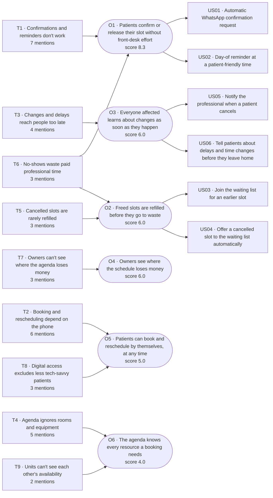

# Discovery report

**Product context:** ClinicFlow, a fictional SaaS for small private clinics (dental, physio, dermatology) to manage appointments. Users: receptionists, clinic owners and patients.

Generated 2026-11-02 03:02 UTC with `demo (replaying Claude Opus 5.5)` from 6 sources: 01_receptionist_dental, 02_owner_physio, 03_patient_parent, 04_receptionist_derma, 05_patient_senior, 06_feedback_batch.

| Pains | Themes | Opportunities | User stories | Quotes verified |
|---|---|---|---|---|
| 36 | 9 | 6 | 6 | 36/36 |

## Opportunities (ranked)

Score = impact × confidence ÷ effort (1–5 each).

| ID | Opportunity | Themes | Impact | Confidence | Effort | Score |
|---|---|---|---|---|---|---|
| O1 | Patients confirm or release their slot without front-desk effort | T1, T6 | 5 | 5 | 3 | **8.3** |
| O2 | Freed slots are refilled before they go to waste | T5, T6 | 4 | 3 | 2 | **6.0** |
| O3 | Everyone affected learns about changes as soon as they happen | T3 | 3 | 4 | 2 | **6.0** |
| O4 | Owners see where the schedule loses money | T7 | 4 | 3 | 2 | **6.0** |
| O5 | Patients can book and reschedule by themselves, at any time | T2, T8 | 5 | 4 | 4 | **5.0** |
| O6 | The agenda knows every resource a booking needs | T4, T9 | 4 | 4 | 4 | **4.0** |

### O1 · Patients confirm or release their slot without front-desk effort

- **How might we:** How might we get every patient to confirm or free their slot in time, without the receptionist sending a single message by hand?
- **Hypothesis:** We believe that automatic WhatsApp confirmations sent at the right time for small clinics will reduce no-shows and manual work. We will know when the no-show rate drops by 30% and manual confirmation messages fall close to zero within 6 weeks.
- **Rationale:** Strongest signal in the research: mentioned in 5 of 6 sources by receptionists, owners and patients, with high severity (no-shows rated 5). Saves hours of receptionist time daily and directly protects revenue. WhatsApp is the channel every persona already uses.

### O2 · Freed slots are refilled before they go to waste

- **How might we:** How might we offer a freed slot to the right waiting patient within minutes, fairly and without exposing personal data?
- **Hypothesis:** We believe that automatically offering cancelled slots to a waiting list for receptionists will recover lost appointments. We will know when at least 30% of cancelled slots are refilled.
- **Rationale:** Raised by both receptionists and the feedback batch; especially painful for long procedure slots. Confidence is moderate (3 mentions) but effort is low if built on top of automated confirmations.

### O3 · Everyone affected learns about changes as soon as they happen

- **How might we:** How might we tell patients and professionals about cancellations, delays and time changes the moment they happen?
- **Hypothesis:** We believe that real-time change notifications for patients and professionals will reduce wasted trips and idle time. We will know when complaints about late notice disappear from NPS comments.
- **Rationale:** Mentioned in 4 sources by patients and physiotherapists. Lower business impact per event, but cheap to deliver once notifications exist, and it prevents wasted trips that damage trust.

### O4 · Owners see where the schedule loses money

- **How might we:** How might we show owners, without spreadsheets, how much the agenda loses and where?
- **Hypothesis:** We believe that a no-show and occupancy dashboard for clinic owners will increase perceived value. We will know when owners' NPS rises and Excel exports drop.
- **Rationale:** Comes from owners (the buyers) in an interview and an NPS 4 detractor; ties directly to retention. Fewer mentions so lower confidence; mostly reporting on data we already have.

### O5 · Patients can book and reschedule by themselves, at any time

- **How might we:** How might we let patients book and move appointments when it suits them, without calling, and without excluding less digital patients?
- **Hypothesis:** We believe that a password-free self-service link to book and reschedule for patients will reduce phone volume and silent no-shows. We will know when 40% of reschedules happen without a call.
- **Rationale:** Mentioned in 5 sources and closely linked to no-shows (patients skip instead of rescheduling). Effort is high because clinic rules (procedures, rooms) must be respected and the experience must work for seniors without passwords; effort estimate is uncertain.

### O6 · The agenda knows every resource a booking needs

- **How might we:** How might we make the schedule aware of rooms, equipment, units and procedure rules so that conflicts become impossible?
- **Hypothesis:** We believe that resource-aware scheduling for clinics with procedures or several units will eliminate double bookings. We will know when resource conflicts reported to support drop to zero.
- **Rationale:** Double bookings are severe (lost patients, public bad reviews) and appear in 4 sources, but mostly in procedure-heavy and multi-unit clinics. Larger change to the scheduling core, so effort is high.

### Opportunity tree



## User stories

### US01 · Automatic WhatsApp confirmation request

> **As a** receptionist, **I want** the system to send each patient a WhatsApp confirmation request automatically before their appointment, **so that** I stop spending my mornings sending messages by hand and can focus on patients at the desk.

Opportunity: O1 · Evidence: P001, P002, P012, P016, P021, P029, P033, P003, P007, P011

**Acceptance criteria**

```gherkin
Scenario 1
  Given an appointment scheduled for tomorrow at 10:00
  When the configured send time arrives (default: 24 hours before)
  Then the patient receives a WhatsApp message with date, time, professional and Confirm / Reschedule / Cancel options
Scenario 2
  Given the patient taps Confirm
  When the reply is received
  Then the appointment status changes to Confirmed in the agenda without any action from the receptionist
Scenario 3
  Given the patient has not replied
  When 4 hours have passed since the request
  Then a single follow-up message is sent and the appointment is highlighted as Unconfirmed in the agenda
Scenario 4
  Given the patient has no valid WhatsApp number
  When the request fails to send
  Then the appointment is flagged for a manual call and appears in the receptionist's to-do list
```

_Notes to validate:_ Validate the default send time per clinic type (procedures may need 48h for preparation). Requires WhatsApp Business API costs to be checked against the SMS cost Marcos complained about.

### US02 · Day-of reminder at a patient-friendly time

> **As a** patient, **I want** a reminder on the day of my appointment, a few hours before it, **so that** I don't forget and still have time to reorganise my day if needed.

Opportunity: O1 · Evidence: P001, P002, P012, P016, P021, P029, P033, P003, P007, P011

**Acceptance criteria**

```gherkin
Scenario 1
  Given a confirmed appointment at 15:00
  When it is 3 hours before the appointment
  Then I receive a WhatsApp reminder with the address and a Reschedule option
Scenario 2
  Given an appointment before 10:00
  When the reminder would fall before 07:00
  Then the reminder is sent at 19:00 the previous evening instead
Scenario 3
  Given I already cancelled the appointment
  When the reminder time arrives
  Then no reminder is sent
```

_Notes to validate:_ Assumes the reminder window can be configured per clinic. Check whether the add-to-calendar link Juliana asked for fits in this story or a separate one.

### US03 · Join the waiting list for an earlier slot

> **As a** receptionist, **I want** to add a patient to a waiting list for a professional or procedure with their preferred days and times, **so that** I have an organised, private list to offer freed slots instead of a notebook or a WhatsApp group.

Opportunity: O2 · Evidence: P004, P022, P036, P003, P007, P011

**Acceptance criteria**

```gherkin
Scenario 1
  Given a patient asks for an earlier appointment
  When I add them to the waiting list with professional, procedure and preferred periods
  Then they appear in the list ordered by request date
Scenario 2
  Given a patient on the waiting list books a regular appointment
  When the booking is saved
  Then they are removed from the waiting list automatically
Scenario 3
  Given a receptionist without permission for patient data
  When they open the waiting list
  Then only names and preferences are shown, never phone numbers of other patients
```

_Notes to validate:_ Validate with Carla whether procedure prerequisites (prior evaluation) must be checked when adding to the list. LGPD: no shared groups.

### US04 · Offer a cancelled slot to the waiting list automatically

> **As a** receptionist, **I want** a cancelled slot to be offered automatically to matching patients on the waiting list, **so that** the slot gets refilled in minutes instead of staying empty.

Opportunity: O2 · Evidence: P004, P022, P036, P003, P007, P011

**Acceptance criteria**

```gherkin
Scenario 1
  Given a slot is cancelled at least 2 hours in advance
  When there are matching patients on the waiting list
  Then the first 3 in order receive a WhatsApp offer with an Accept link
Scenario 2
  Given two patients accept the same offer
  When the second acceptance arrives
  Then the second patient is told the slot was taken and stays on the waiting list
Scenario 3
  Given nobody accepts within 30 minutes
  When the offer expires
  Then the next 3 patients on the list receive the offer
Scenario 4
  Given the slot requires a room or machine
  When the offer is created
  Then it is only offered if the resource is still free
```

_Notes to validate:_ Depends on story US01 (WhatsApp messaging). Offer size and expiry time are assumptions to test.

### US05 · Notify the professional when a patient cancels

> **As a** physiotherapist, **I want** to be notified as soon as one of my patients cancels, **so that** I can use the time for paperwork or another patient instead of waiting.

Opportunity: O3 · Evidence: P013, P018, P027, P034

**Acceptance criteria**

```gherkin
Scenario 1
  Given a patient cancels today's appointment
  When the cancellation is registered by the patient or the receptionist
  Then I receive a notification within 1 minute with the freed time
Scenario 2
  Given the cancellation is for a future day
  When it is registered
  Then it appears in my agenda but no instant notification is sent
Scenario 3
  Given I have turned notifications off
  When a patient cancels
  Then only the agenda is updated
```

_Notes to validate:_ Channel for professionals (app push vs WhatsApp) to be validated.

### US06 · Tell patients about delays and time changes before they leave home

> **As a** patient, **I want** to receive a message when my appointment is delayed or changed, **so that** I don't wait for nothing or make a wasted trip.

Opportunity: O3 · Evidence: P013, P018, P027, P034

**Acceptance criteria**

```gherkin
Scenario 1
  Given the receptionist marks a professional as running 30 minutes late
  When the delay is saved
  Then all patients for the next 2 hours receive a WhatsApp message with the new estimated time
Scenario 2
  Given the clinic changes my appointment time
  When the change is saved
  Then I receive a message with the new time and a Confirm / Reschedule option
Scenario 3
  Given I don't confirm a time change
  When 2 hours have passed
  Then the receptionist sees an alert to call me
```

_Notes to validate:_ Messages must use large, simple text and no login, so that senior patients like Pedro can act on them.

## Themes and evidence

### T1 · Confirmations and reminders don't work

Confirming appointments is manual, costly and badly timed: front desks spend hours on it, many patients never answer, and reminders arrive too early or too late to change behaviour.

7 mentions · 5 sources · avg severity 3.3

| Pain | Persona | Sev. | Statement | Quote | Source |
|---|---|---|---|---|---|
| P001 | Receptionist | 4 | Confirming tomorrow's appointments means sending dozens of WhatsApp messages by hand, which takes most of the morning. | “One by one. I copy the name, the time, the dentist, paste it in a message and send it.” | 01_receptionist_dental |
| P002 | Receptionist | 3 | Many patients ignore confirmation messages, so the receptionist has to follow up with phone calls. | “Half of them don't answer. So in the afternoon I call the ones who didn't reply.” | 01_receptionist_dental |
| P012 | Clinic owner | 3 | SMS reminders are expensive and patients don't answer them because they use WhatsApp. | “it's expensive per message and the patients don't reply to SMS anyway.” | 02_owner_physio |
| P016 | Patient | 3 | Reminders sent two days before are too early to prevent a busy parent from forgetting. | “two days before doesn't help me — I need a reminder on the day, a few hours before.” | 03_patient_parent |
| P021 | Receptionist | 4 | Preparation instructions for procedures are sent by hand and sometimes forgotten, so the patient arrives unprepared and the slot is lost. | “Sometimes I forget, and the patient arrives unprepared and we have to reschedule. The whole slot is lost.” | 04_receptionist_derma |
| P029 | Receptionist | 4 | Sending WhatsApp confirmations one by one takes the receptionist's whole morning. | “Sending confirmations one by one on WhatsApp takes my whole morning.” | 06_feedback_batch |
| P033 | Patient | 2 | A reminder one hour before the appointment is too late for the patient to reorganise. | “Received the reminder at 7am for an appointment at 8am. Way too late to reorganise my day.” | 06_feedback_batch |

### T2 · Booking and rescheduling depend on the phone

Patients can only book or move appointments by calling during business hours; lines are busy, receptionists are overloaded and some patients simply skip instead of rescheduling.

6 mentions · 4 sources · avg severity 3.3

| Pain | Persona | Sev. | Statement | Quote | Source |
|---|---|---|---|---|---|
| P005 | Receptionist | 3 | Handling reschedule requests by phone is slow and keeps the line busy for other patients. | “I have to check the dentist's agenda, the room, and it takes forever while the line is ringing again.” | 01_receptionist_dental |
| P014 | Patient | 4 | Booking requires calling during a short window, and the line is often busy. | “I called three times during my lunch break and the line was always busy.” | 03_patient_parent |
| P015 | Patient | 3 | The clinic can only be reached during business hours, which overlap with the patient's own working hours. | “At night, when I actually have time to organise the family's agenda, there's nobody there.” | 03_patient_parent |
| P017 | Patient | 4 | Rescheduling requires another call, so the patient sometimes skips the appointment instead of cancelling. | “Sometimes I just give up and don't go, which I know isn't fair to the clinic.” | 03_patient_parent |
| P026 | Patient (senior) | 2 | Phone calls to the clinic often take long to be answered. | “sometimes it takes a long time for them to answer, and I have to call back.” | 05_patient_senior |
| P031 | Patient | 4 | Patients can't reschedule without calling the clinic. | “Impossible to reschedule without calling. I tried for two days.” | 06_feedback_batch |

### T3 · Changes and delays reach people too late

Cancellations, delays and time changes are not communicated proactively, so professionals sit idle and patients wait or travel for nothing.

4 mentions · 4 sources · avg severity 3.0

| Pain | Persona | Sev. | Statement | Quote | Source |
|---|---|---|---|---|---|
| P013 | Physiotherapist | 3 | Physiotherapists learn about cancellations only when they are already waiting, so they can't use the time. | “They complain that they find out about cancellations only when they're already waiting for the patient.” | 02_owner_physio |
| P018 | Patient | 2 | Patients aren't told when the doctor is running late and wait a long time at the clinic. | “Nobody told us the doctor was running late.” | 03_patient_parent |
| P027 | Patient (senior) | 4 | Schedule changes are communicated only on arrival, so the patient makes a wasted trip. | “I took two buses to get there for nothing.” | 05_patient_senior |
| P034 | Physiotherapist | 3 | Professionals only learn about a cancellation when they are already waiting. | “I only know a patient cancelled when I'm already waiting for them.” | 06_feedback_batch |

### T4 · Agenda ignores rooms and equipment

The schedule only tracks professionals, so rooms, shared machines and procedure rules live in side spreadsheets or paper, causing double bookings and angry patients.

5 mentions · 3 sources · avg severity 4.0

| Pain | Persona | Sev. | Statement | Quote | Source |
|---|---|---|---|---|---|
| P006 | Receptionist | 4 | Keeping a paper agenda alongside the software leads to double bookings. | “Last month I booked two patients at the same time with him because the paper one wasn't updated.” | 01_receptionist_dental |
| P019 | Receptionist | 5 | The schedule only blocks the doctor's time, not rooms or shared equipment, so the receptionist tracks the machine in a separate spreadsheet. | “The system only blocks the doctor's time. So I keep a separate spreadsheet for the machine.” | 04_receptionist_derma |
| P020 | Receptionist | 4 | Equipment conflicts make patients wait, leave and post bad public reviews. | “One patient waited an hour and left. She posted a bad review on Google.” | 04_receptionist_derma |
| P023 | Receptionist | 3 | Online self-booking could break procedure rules such as room, equipment or a required prior evaluation. | “For procedures I'm afraid, because they'd book without the room or the machine, or without the evaluation they need first.” | 04_receptionist_derma |
| P030 | Receptionist | 4 | Rooms are not part of the schedule, which allows double bookings of the same room. | “Two patients were booked in the same room at 3pm because the room is not part of the schedule, only the professional.” | 06_feedback_batch |

### T5 · Cancelled slots are rarely refilled

When a slot frees up, offering it to people who want an earlier time is manual, slow and sometimes privacy-unsafe, so the slot is usually lost.

3 mentions · 3 sources · avg severity 3.3

| Pain | Persona | Sev. | Statement | Quote | Source |
|---|---|---|---|---|---|
| P004 | Receptionist | 4 | Offering a cancelled slot to people waiting for an earlier appointment is manual and too slow, so the slot usually goes unused. | “I have to call each one and by the time someone says yes, the time has passed. Most of the time the slot just stays empty.” | 01_receptionist_dental |
| P022 | Receptionist | 3 | The waiting list for long procedure slots runs on a WhatsApp group, which is a privacy risk and chaotic. | “I'm not supposed to use a group like that because of privacy. And whoever answers first gets it, it's chaos.” | 04_receptionist_derma |
| P036 | Receptionist | 3 | There's no quick way to offer a cancelled slot to the waiting list. | “When someone cancels I have no fast way to offer the slot to the waiting list.” | 06_feedback_batch |

### T6 · No-shows waste paid professional time

Patients miss appointments even after confirming, and clinics have no practical way to discourage it, so paid professional hours go unbilled.

3 mentions · 2 sources · avg severity 4.0

| Pain | Persona | Sev. | Statement | Quote | Source |
|---|---|---|---|---|---|
| P003 | Receptionist | 5 | Patients who confirmed still don't show up, leaving dentists idle. | “And even when they say yes, some still don't come. Yesterday we had four no-shows.” | 01_receptionist_dental |
| P007 | Clinic owner | 5 | Every no-show or late cancellation is professional time the clinic pays for and cannot bill. | “If a patient doesn't show up, that's 50 minutes I'm paying the professional for and getting nothing.” | 02_owner_physio |
| P011 | Clinic owner | 2 | Cancellation fees are hard to enforce manually and create conflict with patients, so they are never charged. | “The receptionist has to remember, call the patient, it creates conflict. In the end nobody charged it.” | 02_owner_physio |

### T7 · Owners can't see where the agenda loses money

There is no reporting on no-shows, idle slots or patterns, so owners rebuild numbers in Excel after the fact and can't act on them.

3 mentions · 2 sources · avg severity 3.3

| Pain | Persona | Sev. | Statement | Quote | Source |
|---|---|---|---|---|---|
| P008 | Clinic owner | 4 | The system has no report on no-shows or empty slots, so the owner rebuilds it in Excel at month end, when it's too late to act. | “there's no report of who didn't come, which professional has more empty slots, which day of the week is worse.” | 02_owner_physio |
| P009 | Clinic owner | 3 | Without data on patterns, the owner can't take targeted actions such as asking repeat no-show patients for a deposit. | “If I knew a specific patient misses all the time, I'd ask for a deposit. Today I'm flying blind.” | 02_owner_physio |
| P028 | Clinic owner | 3 | The owner still needs a spreadsheet to know the number of no-shows. | “I still need a spreadsheet to know how many no-shows I had.” | 06_feedback_batch |

### T8 · Digital access excludes less tech-savvy patients

Passwords, email codes and small text make apps unusable for some patients, who fall back to the phone.

3 mentions · 2 sources · avg severity 3.0

| Pain | Persona | Sev. | Statement | Quote | Source |
|---|---|---|---|---|---|
| P024 | Patient (senior) | 4 | Apps with complex passwords and email verification codes lock out older patients. | “It asked for a password with capital letters and numbers, and then it sent a code to an email I don't check. I gave up.” | 05_patient_senior |
| P025 | Patient (senior) | 2 | Small text in apps is hard to read for older patients. | “The letters are tiny too.” | 05_patient_senior |
| P035 | Patient | 3 | Password recovery fails, pushing patients back to the phone. | “Created an account, forgot the password, the reset email never arrived.” | 06_feedback_batch |

### T9 · Units can't see each other's availability

Multi-unit clinics run separate agendas, so a patient is turned away at one unit while another has free slots.

2 mentions · 2 sources · avg severity 3.5

| Pain | Persona | Sev. | Statement | Quote | Source |
|---|---|---|---|---|---|
| P010 | Clinic owner | 4 | Each unit only sees its own agenda, so patients are turned away while the other unit has free slots. | “the receptionist doesn't know that unit B has three free slots that afternoon. We lose the patient to a competitor because of that.” | 02_owner_physio |
| P032 | Clinic owner | 3 | Owners can't see the agenda of their other unit. | “I can't see the agenda of my other unit from this one.” | 06_feedback_batch |
